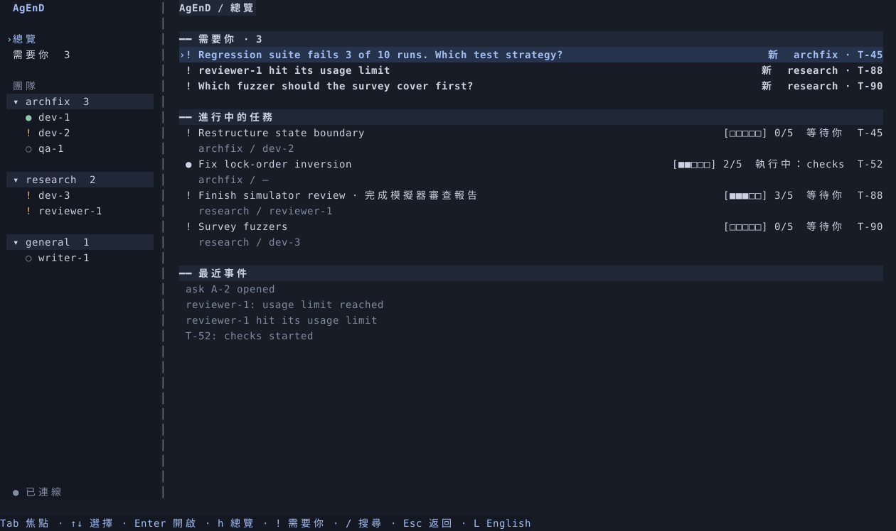

# AgEnD

**讓不同 AI agent 組隊工作，你集中處理需要決定的事。**

派工、獨立工作目錄、檢查、審查、合併，由本機 daemon 串成一條流程。

**macOS · Linux**　｜　**Claude · Codex · OpenCode**　｜　**終端介面 · Telegram**

[安裝](#安裝) · [開始使用](#開始使用) · [第一個任務](docs/first-task.md) · [文件](#文件)



<sub>原生終端介面，以示範資料呈現。寬視窗顯示側欄，窄視窗自動切換單欄。</sub>

## 為什麼用 AgEnD？

| 你想做的事 | AgEnD 怎麼幫忙 |
|---|---|
| **讓不同模型分工** | 把 Claude、Codex、OpenCode 放進同一團隊，依角色派工與互審。 |
| **少盯幾個視窗** | 權限請求、問題與審查集中在「需要你」；也能透過 Telegram 處理通知與核准。 |
| **有檢查再合併** | 工作流程串接 checks 與審查，核准綁定提交；變更後重新判斷合併資格。 |
| **多個 agent 同時做事** | 任務使用獨立 Git worktree，合併由 daemon 協調。 |
| **隨時查看、接手** | 在 TUI 開啟 agent 的原生終端，需要時取得輸入控制。 |
| **重啟管理程式仍能續跑** | holder 獨立持有 agent 程序；daemon 重啟後可以重新接回。 |

```text
你建立任務 → agent 開發 → 執行檢查 → 審查／核准 → 合併
                                      ↑
                              需要你時，集中提醒
```

> **目前為試用版。** 安裝方式是從原始碼建置；尚未提供 v2 公開 Release 或 Brew 安裝。Claude 的通訊已接入，但受管版本的真模型升級／回退驗收仍暫緩。[完整進度與限制 →](docs/gates/gate-13-status.md)

## 安裝

**先備好：** Git 2.38 以上、[rustup](https://rustup.rs/) 管理的 Rust，以及 macOS 或 Linux 的本機編譯工具。專案會自動選用 Rust 1.96.0。

### 1 · 下載原始碼

```sh
git clone --branch v2 https://github.com/suzuke/AgEnD.git agend-v2
cd agend-v2
```

### 2 · 安裝命令列程式

```sh
cargo install --locked --path crates/agend --root "$HOME/.local"
export PATH="$HOME/.local/bin:$PATH"
```

首次編譯需要一些時間。若希望新終端也能使用 `agend`，把上面的 `export PATH=…` 加入自己的 `~/.zshrc` 或 `~/.bashrc`。

### 3 · 確認安裝成功

```sh
agend --version
```

看到 `agend 0.0.0` 即代表目前試用版已安裝。[前置工具、更新與其他安裝方式 →](docs/install-release.md)

## 開始使用

以下使用已安裝、已登入且能正常回覆的 **OpenCode**（[安裝與登入說明](https://opencode.ai/docs/)）。還沒有模型帳號？可以先看下方的免登入示範。

### 終端 A · 建立資料目錄

```sh
export PATH="$HOME/.local/bin:$PATH"
export AGEND_HOME="$HOME/agend-trial"
agend init
```

daemon 尚未啟動的警告是正常的。**其他 `fail` 請先按 `fix:` 處理**，再執行：

```sh
agend daemon
```

看到 **`agend daemon ready`** 後，保持這個終端開啟。

### 終端 B · 加入 agent，開啟介面

```sh
export PATH="$HOME/.local/bin:$PATH"
export AGEND_HOME="$HOME/agend-trial"
agend instance add try-opencode opencode
agend app --lang zh-TW
```

1. 按 `/` 搜尋 `try-opencode`，按 Enter 開啟終端。
2. 按 `i` 取得控制，即可與它對話。
3. 按 `Ctrl-]` 退出輸入模式，再按 Esc 返回。

**接著試派工：** [建立第一個任務 →](docs/first-task.md)　[完整操作與結束試用 →](docs/quickstart.md)

<details>
<summary><strong>只想先看介面？不登入、不啟動模型</strong></summary>

在剛才的 `agend-v2` 原始碼目錄執行：

```sh
cargo run --locked -p agend-tui --example tui_fake -- --lang zh-TW
```

按 `!` 看待辦、按大寫 `P` 預覽四種配色、按 `q` 離開。畫面使用示範資料。

</details>

## 常用操作

| 操作 | 按鍵 |
|---|---|
| 首頁／需要你 | `h`／`!` |
| 上一項／下一項待辦 | `[`／`]` |
| 搜尋 agent | `/` |
| 配色／中英文切換 | 大寫 `P`／`L` |
| 離開管理介面 | `q`（agent 仍會執行） |

遇到問題先執行 `agend doctor`，確認兩個終端的 `AGEND_HOME` 相同。[故障排除與停止 agent →](docs/quickstart.md#遇到問題)

## 文件

[使用教學](docs/quickstart.md) · [任務教學](docs/first-task.md) · [進度](docs/ROADMAP.md) · [架構](docs/ARCHITECTURE.md) · [開發指南](AGENTS.md)

Apache-2.0 · [LICENSE](LICENSE) · [NOTICE](NOTICE)
